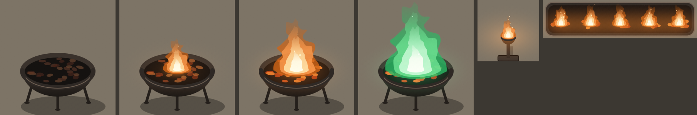

# Brazier (fire, seen from above)

Fire for scene tiles, in three artboards that share one view model, drawn as a map tile sees it: **from above, at an angle**. The bowl's rim is an ellipse with its side showing below, and the flames stand up the screen out of the coals. The flames are a **script** (`flame.luau`); the coals, the bowl and the glow are markup. `scene.rml` is generated: edit `tools/gen_scene.py` and run `py -I tools/gen_scene.py`.

*On a stand-in floor colour: out, intensity 0.4, the default, green at 1.5, the torch, and the trough.*

| Artboard | Size | Use |
|---|---|---|
| `Brazier` | 300×300 | An iron bowl of coals on three legs, with its fire and glow. A 3×3 tile at 100 px squares. Contain fit. |
| `Torch` | 160×160 | A wall torch seen from above; the wall runs along the bottom edge, so rotate the tile to face the wall. |
| `Trough` | 400×100 | A long fire trough built from flex boxes, for the **Layout** fit: a longer or deeper tile gets a longer or deeper trough, with its five fires spread along it, instead of a stretched one. Made for 3:1 and longer. |

## Data (view model `Fire`)

| Property | Type | Default | Does |
|---|---|---|---|
| `lit` | boolean | true | Lights or puts out the fire; it fades over 0.6 s and the embers keep a faint glow. |
| `intensity` | number | 1 | 0 to 1.5: the fire's size and the glow's strength (eased). |
| `color` | color | `#FF7A1A` | The flame and glow colour, for magic fire. The flame's inner layers lean towards a warm white; the coals stay as they are. |
| `flare` | trigger | | A burst: the fire leaps up, rougher and showering embers, and settles. |

## Signing

The runtime refuses unsigned scripts, so **a local `rive . --once` build shows the bowl and the glow but no flames** on the web. Build releases with `rive . --publish`, which signs the script. Until the project is bound to a Rive file with `rive push`, a published file is watermarked: it shows a few seconds of black with the Rive logo before it plays.

## How it's built

- **The flame** (`flame.luau`, a `ScriptedDrawable` per fire) draws four layers, outermost first: a teardrop that narrows into a tongue at the top and flattens where it sits on the coals. Each layer's edge is pushed in and out by four octaves of Perlin noise sampled in a field that scrolls upward, so bumps travel up the edge, split into tongues and leave the tip. The outer two layers paint normally, so they keep their colour over a light floor; the inner two are screened on top, towards warm white, for the heat. Each layer fades to transparent at its tip. Embers rise, drift and wink out, more of them during a flare.
- **Inputs:** `level` (lit × intensity, eased, through the same converters as the glow), `color`, `flare` (a trigger), `size` (the flame's width in points) and `seed` (so fires side by side flicker differently). The script runs on every frame: each fire takes about 1,000 noise samples (4 layers × 64 points × 4 octaves), so the trough takes about 5,000.
- **Markup:** a hot spot on the coals and a glow on the floor (radial gradients, screen-blended, squashed for the angle), and the coals, whose hot layer fades with the fire. The rim is drawn in two halves, the front over the fire's base and the back behind it.
- `lit` and `intensity` drive everything through converter groups: boolean to number, `lit × clamp(intensity, 0, 1.5)`, a 0.6 s interpolator, then one formula per use (hot spot opacity, glow opacity, coal heat; the flame takes the eased level as is).
- `flare` reaches the script through a trigger input, and also plays a one-shot on its own state machine layer that swells the glow.

Checked with CLI screenshots (each state above, and frames a sixth of a second apart for the motion) and, with a signed build, in the 2.44.2 web runtime the module uses: all three artboards load and play, and `lit`, `color` and `flare` changed live behave as described.
