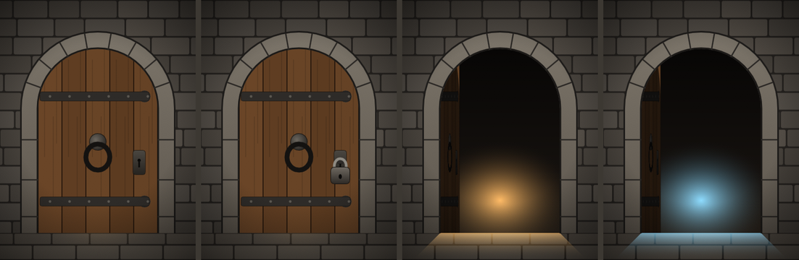

# Door (a journal set piece)

A door in a stone archway, for a GM to show players on a Rive journal page: it's knocked on, it rattles when someone tries it, it's locked, it opens on whatever is beyond. Doors are hard to read top-down, so this one is drawn **from the front**, like the scroll. Built with the Rive CLI, **no scripts**, so a local build (`rive . --once`) runs on web runtimes without signing. `scene.rml` is generated: edit `tools/gen_scene.py` and run `py -I tools/gen_scene.py`.

*Closed, locked, open, and open with `color` set to pale blue.*

| Artboard | Size | Use |
|---|---|---|
| `Door` | 360×480 | A journal page (aspect ratio `auto` keeps its proportions) or an inline embed. Contain fit. |

## Data (view model `Door`, state machine `Door`)

| Property | Type | Default | Does |
|---|---|---|---|
| `state` | enum | `closed` | `closed`; `open` (the door gives a little, then swings inward on its left hinge, and the light beyond spills onto the floor); `locked` (a padlock swings onto the hasp; leaving `locked`, it drops to the floor). |
| `color` | color | `#FFB45A` | The light beyond the door: torchlight by default, pale blue for something cold or magical. |
| `knock` | trigger | | The ring knocker raps three times; the door jolts on each blow and dust falls from the arch. |
| `rattle` | trigger | | The door shakes in its frame, and the knocker swings (someone trying the handle). |

The page loads straight into its saved `state`, with no animation. `knock` and `rattle` are momentary, so they're the right fit for the module's live sync: a player joining later sees the current `state`, not past knocks.

## How it's built

- **The swing:** the door is a node pivoting on the hinge line, and opening scales its width to 16% while a black overlay fades in, as a door turning away from the light would look. It's clipped to the doorway, so it never covers the stone surround.
- **Layers:** the state machine has four. *Door* (shut, opening, open, closing: open while `state` is `open`); *Lock* (the padlock: on while `state` is `locked`); *Knock* and *Rattle* (the triggers). Each moves a different node (the door's hinge, the padlock, and two nested shake nodes), so they never fight: a locked door can be knocked on and rattled.
- **The surround** is one path round the arch and down the jambs, stroked 30 px wide in stone, with joints drawn across it. The wall's blocks and the floor's flagstones are placed by a seeded random, so a rebuild gives the same wall.
- **The light** behind the door and the spill on the floor are screen-blended gradients whose first stop is bound to `color`.
- **Draw order:** in RML the first child draws on top, so the generator writes the front-most pieces first and the wall last.

Checked with CLI screenshots of every state, and in the 2.44.2 web runtime the module uses, with `Fit.Contain`: opening, closing, locking, unlocking straight into `open`, `knock` and `rattle` all play as described, and `color` changed live recolours the light.
