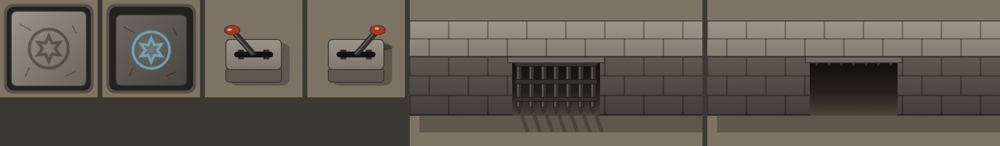

# Mechanisms (a pressure plate, a lever and a portcullis)

Pieces for wiring one tile to another with Monk's Active Tile Triggers (MATT): a token steps on the plate, or someone pulls the lever, and the gate opens. Each artboard is its own tile with its own view model. The plate lies flat, so it's drawn straight down; the lever and the gate stand up, so they're drawn **from above, at an angle**, with shadows on the ground. Built with the Rive CLI, **no scripts**, so a local build (`rive . --once`) runs on web runtimes without signing. `scene.rml` is generated: edit `tools/gen_scene.py` and run `py -I tools/gen_scene.py`.

*On a stand-in floor colour: the plate up and pressed, the lever up and pulled, the gate closed and open.*

| Artboard | Size | Use |
|---|---|---|
| `Plate` | 100×100 | A stone slab set in the floor. One grid square. |
| `Lever` | 100×100 | A floor lever on a stone block. One grid square. |
| `Gate` | 300×150 | A portcullis in a stretch of wall, three squares wide. Line the wall's face up with a Foundry wall, and open that wall's door when the gate opens. |

All three use the Contain fit.

## Data

| Artboard (view model) | Property | Type | Default | Does |
|---|---|---|---|---|
| `Plate` (`Plate`) | `pressed` | boolean | `false` | The slab sinks with a puff of dust, and its rune lights. It rises again when set back to `false`. |
| | `color` | color | `#6FD3FF` | The rune's light. |
| `Lever` (`Lever`) | `pulled` | boolean | `false` | The arm swings from left to right, and back when set to `false`. A click on the lever toggles it where the runtime passes clicks on (journal pages; on the canvas, use a MATT click trigger). |
| `Gate` (`Gate`) | `open` | boolean | `false` | The portcullis is hauled up behind the lintel in jerks of the chain; set back to `false`, it drops and bounces. |
| | `rattle` | trigger | | The portcullis shakes in its grooves (a failed lift, a creature behind it). |

Each artboard loads straight into its saved value, with no animation.

## Wiring it with MATT

- **Plate → gate:** on the plate tile, an **Enter** trigger with **Set Rive value** `pressed` = `true` on **This Tile**, then **Set Rive value** `open` = `true` on the gate tile (pick it with a Tagger tag or by id), **Remember** ticked on both. An **Exit** trigger sets both back to `false` for a plate that must be held down.
- **Lever → gate:** on the lever tile, a **Click** trigger with **Get Rive value** `pulled`, a **Check value** branch, and **Set Rive value** to the opposite on the lever and on the gate.
- To let tokens through, also open the Foundry door the gate stands on (MATT's **Change Door State**).

## How it's built

- **Plate:** the slab is a node that shrinks by 6% and drops 1.5 px as it sinks, so the dark gap round it widens. A black overlay on it fades to 30%. The rune's glow is a screen-blended copy of the rune's path plus a radial halo, both bound to `color`. Ten dust puffs drift out of the gap during the press.
- **Lever:** the arm stands in a node squashed to 62% of its height, so rotating it traces an ellipse, as an upright arm seen from above does. Its shadow is a flatter copy keyed with the same rotation, offset onto the ground. A transparent hit area covers the artboard for the click listener, which writes `not pulled` back to `pulled`.
- **Gate:** the wall is the top surface (two courses) and the foreshortened face (three courses), with a gap in the face for the passage. The portcullis is clipped to the gateway, so as it rises it disappears behind the lintel until only its spike tips show. The bars' shadows on the ground fade as it lifts. `rattle` is a separate layer that shakes a parent node, so it works open or closed.
- **Draw order:** in RML the first child draws on top, so each artboard lists its pieces front-most first.

Checked with CLI screenshots of every state, and in the 2.44.2 web runtime the module uses, with `Fit.Contain`: `pressed`, `open` and `rattle` changed live animate as described, `color` recolours the rune, and a click on the lever toggles `pulled`.
