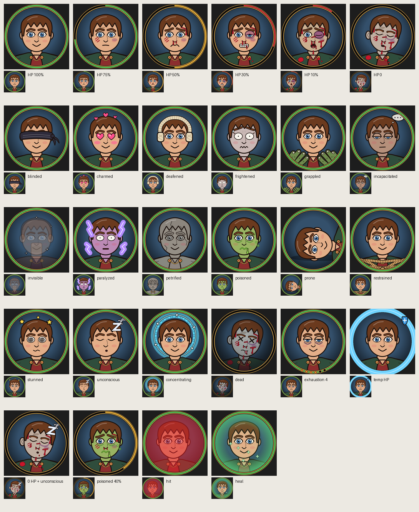
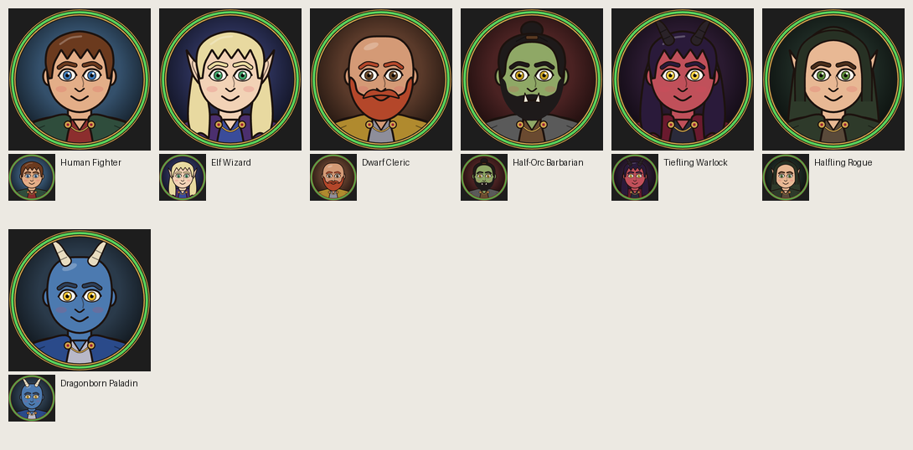

# Responsive Character Token

A 512×512 Rive token: the head and shoulders of a generic fantasy adventurer.
The face takes progressively more damage as HP drops (a Wolfenstein-style status
portrait), and the token reacts visibly to every D&D 5e condition. Everything is
driven by **one view model, `CharacterToken`**, so a host (Foundry VTT or anything
else) only has to set properties.




## Files

| File | What it is |
|---|---|
| `scene.rml` | The Rive document. **Generated — do not hand-edit.** |
| `tools/build_token.py` | Generator: view model, art, HP stages, state machine, presets |
| `tools/conditions.py` | Condition overlays (loaded by the generator) |
| `tools/rml.py`, `tools/formula.py` | Small helpers for emitting RML and formula converters |
| `tools/sheet.py` | Renders labelled contact sheets for visual checks |

```bash
python3 tools/build_token.py   # regenerate scene.rml
rive . --verify                # compile check
rive .                         # live previewer
rive . --once                  # write build/ResponsiveToken.riv
python3 tools/sheet.py out.png "label|--data=hp=9 --data=poisoned=true"
```

## Data contract (`CharacterToken`)

### Health

| Property | Type | Default | Effect |
|---|---|---|---|
| `hp` | number | 30 | Current HP |
| `maxHp` | number | 30 | Max HP (values ≤ 0 are treated as 1) |
| `tempHp` | number | 0 | Any value > 0 shows a blue shield ring and badge |
| `showHpRing` | bool | true | Green/amber/red arc on the frame, filled to `hp/maxHp` |
| `hit` | trigger | – | Red flash and shake (fire it when damage is taken) |
| `heal` | trigger | – | Green glow with rising motes |

The token computes `health = hp / maxHp` itself. Wounds **accumulate**:

| Stage | Health | Look |
|---|---|---|
| Healthy | > 75% | Smile |
| Scuffed | ≤ 75% | Cheek scratches, bruise, dirt; neutral mouth |
| Bloodied | ≤ 50% | Bloody nose, brow gash, pained brows, grimace |
| Battered | ≤ 30% | Black eye (half shut), forehead blood, split lip, sweat, gritted teeth |
| Critical | ≤ 10% | Eye swollen shut, heavy bleeding, pale skin, gasping |
| Down | 0 | Eyes closed, head slumps, grey pallor |

HP ring colour: green > 50%, amber 30–50%, red ≤ 30%.

### Conditions (all booleans, default `false`)

| Property | Visual |
|---|---|
| `blinded` | Dark blindfold with knot tails |
| `charmed` | Heart eyes, blush, hearts bobbing overhead |
| `deafened` | Bandage wrap over the head and ear pads |
| `frightened` | Wide eyes, raised brows, wobbly mouth, sweat, pale tint, trembling |
| `grappled` | Two clawed hands gripping the shoulders |
| `incapacitated` | Heavy lids, flat mouth, dim tint, "…" bubble |
| `invisible` | Character fades to 28% with twinkling sparkles |
| `paralyzed` | Violet tint, rigid stare, flickering lightning |
| `petrified` | Everything turns to cracked stone |
| `poisoned` | Green skin, queasy mouth, drool, rising bubbles |
| `prone` | Character lies on their side with a ground shadow |
| `restrained` | Ropes lashed across the chest |
| `stunned` | Spiral eyes, stars orbiting the head |
| `unconscious` | Closed eyes, open mouth, floating Z's |
| `concentrating` | Rotating cyan rune halo behind the head |
| `dead` | X eyes, tongue out, grey skin, dark shroud |
| `exhaustion` *(number 0–6)* | Pips on the frame's bottom arc; eye bags deepen; sweat at 2+; drooping lids at 3+ |

Conditions are independent state-machine layers, so any combination works (for
example poisoned + charmed + 40% HP). Each one fades in and out over about 250 ms
(450 ms for prone, invisible and petrified).

### Appearance

| Property | Type | Notes |
|---|---|---|
| `skinColor`, `hairColor`, `eyeColor` | color | Hair colour also drives brows, beard and mustache |
| `outfitColor` | color | Tunic |
| `cloakColor` | color | Shoulder mantle and hood |
| `hornColor` | color | |
| `backgroundColor` | color | Disc behind the character (try disposition colours) |
| `frameColor` | color | Gilt trim, rivets, clasps, pip sockets |
| `hairStyle` | enum | `short`, `long`, `topknot`, `bald`, `hood` |
| `beardStyle` | enum | `none`, `stubble`, `mustache`, `full` |
| `earStyle` | enum | `round`, `pointed` |
| `horns`, `tusks` | bool | |

Shading and outlines are drawn as dark overlays, so any skin, hair or cloth colour
works without per-colour artwork.

### Instances

`Default` (Human Fighter) plus presets: **Elf Wizard, Dwarf Cleric, Half-Orc
Barbarian, Tiefling Warlock, Halfling Rogue, Dragonborn Paladin**. They are
exported, so a runtime can start from one and override individual properties.

## Foundry notes (for the integration task)

- dnd5e status ids map one-to-one onto the condition booleans (`blinded`,
  `charmed`, `deafened`, `frightened`, `grappled`, `incapacitated`, `invisible`,
  `paralyzed`, `petrified`, `poisoned`, `prone`, `restrained`, `stunned`,
  `unconscious`, `concentrating`, `dead`). Exhaustion is the actor's numeric
  `attributes.exhaustion`.
- `hp`, `maxHp` and `tempHp` come from `system.attributes.hp.{value,max,temp}`.
  Fire `hit` or `heal` by comparing the old and new value in `updateActor`.
- Foundry already draws its own bars, so set `showHpRing=false` if they overlap.
- The token is one artboard (`Token`) with one state machine (`Token Machine`).
  Bind the default view model instance and set properties by name.

## How it is built

- **HP stages** are opacity binds on stage groups. Each bind runs `hp` through a
  `DataConverterFormula` that also reads `maxHp`. A steep clamp turns the health
  fraction into a 0/1 step, so there is no host-side math and no state per stage.
- **Tints** (poison, fright, paralysis, death, pallor, stone) are extra fills
  stacked on every skin, hair, cloth and eye shape. State-machine layers key their
  alpha, so a tint follows each shape's exact outline and the outlines stay crisp.
- **Condition overlays** sit at fixed depths: behind the body (halo), on the face
  (eyes and mouths, which cover the base features with skin-coloured patches),
  above the hair (headgear, FX), and over the body (hands, ropes).
- The previewer runs the `Token Machine` state machine. Binds only apply while it
  is running.

## Tweaking

Change art, colours or thresholds in `tools/`, then rerun the generator. The
stage thresholds live in `build_mouths`, `build_eyes`, `build_eye_damage` and
`build_wounds` (`hp_le(0.5)` means "health ≤ 50%").
