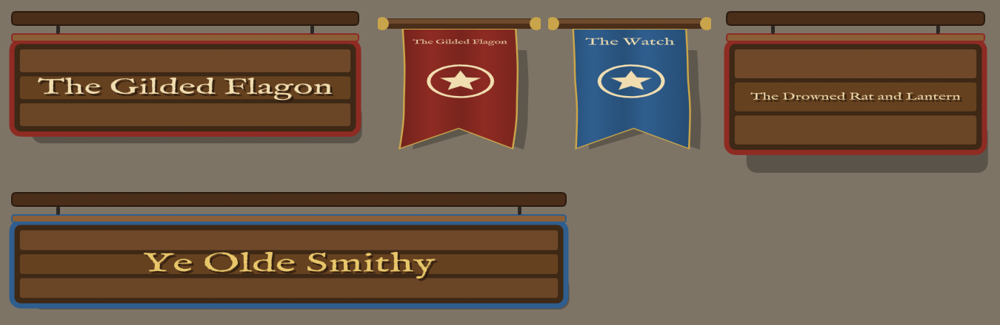

# Sign (a hanging signboard and a banner, seen from above)

Text bound to data, in two artboards that share one view model. Both are drawn as a map tile sees them: **from above, at an angle**. The beam or pole faces the camera, the board or cloth hanging below it is foreshortened, and its shadow lies on the ground. Built with the Rive CLI, **no scripts**, so a local build (`rive . --once`) runs on web runtimes without signing. `scene.rml` is generated: edit `tools/gen_scene.py` and run `py -I tools/gen_scene.py`.

*On a stand-in floor colour. Top: the default sign, the two banners (default and recoloured), and the sign at 360×230 with a long name. Bottom: the sign laid out at 760×170 in blue with gold lettering.*

| Artboard | Size | Use |
|---|---|---|
| `Sign` | 480×190 | A wooden signboard hanging from a beam, built from flex boxes for the **Layout** fit: a longer or deeper tile gives a longer or deeper sign (the chains stay near the ends), and the lettering shrinks to fit whatever text it gets. Its shadow sways on the ground, and the board jolts when `swing` fires. |
| `Banner` | 220×240 | A swallowtail cloth banner hanging from a pole, rippling in the wind, with a star emblem, the same text, and a rippling shadow. Contain fit. |

## Data (view model `Sign`)

| Property | Type | Default | Does |
|---|---|---|---|
| `text` | string | `The Gilded Flagon` | The sign's lettering and the banner's title, one line, shrunk to fit. |
| `color` | color | `#8E2B23` | The banner's cloth and the sign's painted edge. |
| `textColor` | color | `#F0DDB0` | The lettering, and the banner's emblem. |
| `swing` | trigger | | The sign swings and settles (as when someone bumps it). |

## How it's built

- **The view from above:**
  - The sign is a flex column. From the top: the beam, the chains, the board's top edge, then the board, short for its width, so it reads as tilted away. The lettering is squashed to 60% of its height about its centre. The ground shadow is the last row, pulled up under the board with a negative margin and offset to the right.
  - The banner's cloth, emblem and title are in a node squashed to half height under the pole, with a second, flatter copy of the cloth in translucent black as its shadow.
- **Sign layout:** the board is a `stack`, so the planks (a flex column), the lettering's shadow and the lettering overlap. The lettering is a `Text` with a `fill` participant and `fitFontSize`, capped at 64 px so it never asks for more height than the board has.
- **Motion:** the sign's shadow sways. The swing (a later layer, so it overrides the sway) jolts the board and swings the shadow. The banner's side vertices and tails ripple more the further down they are. A band of shadow folds (a linear gradient) drifts with the wave, and the emblem and title follow the ripple.
- **Font:** IM Fell English (SIL Open Font License, `fonts/OFL.txt`).

**A note for later samples:** a transform (scale or rotation) on a layout box that the Layout fit resizes didn't give a stable result here. Squash the drawables inside instead (a `Text`, a `Node`), as this file does.

Checked with CLI screenshots at 360–900 px wide and 170–260 px deep, and in the 2.44.2 web runtime the module uses, with `Fit.Layout`: every artboard loads, and `text`, `color` and `swing` changed live behave as in the CLI.
