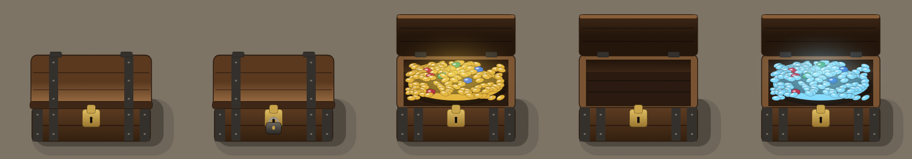

# TreasureChest (a reward beat, seen from above)

A banded wooden chest that opens on cue, for a MATT reward beat or a GM's reveal. It's drawn as a map tile sees it: **from above, at an angle**. The lid's top faces the camera, the front is foreshortened, and the chest's shadow lies on the ground. Opening, the lid swings up on its back hinge and stands behind the chest showing its inside face, and the heap of coins inside glows. Built with the Rive CLI, **no scripts**, so a local build (`rive . --once`) runs on web runtimes without signing. `scene.rml` is generated: edit `tools/gen_scene.py` and run `py -I tools/gen_scene.py`.

*On a stand-in floor colour: closed, locked, open, empty, and open with `color` set to pale blue.*

| Artboard | Size | Use |
|---|---|---|
| `Chest` | 320×320 | A scene tile, Contain fit. About a 1×1 square at 100 px a square; the open lid needs the top quarter of the artboard. |

## Data (view model `Chest`, state machine `Chest`)

| Property | Type | Default | Does |
|---|---|---|---|
| `state` | enum | `closed` | `closed`, `open` (the lid swings up, sparkles burst out of the heap), `empty` (the lid opens on a bare floor; set from `open`, the coins fade away). |
| `color` | color | `#E3B23C` | The treasure: coins, glow and sparkles. Pale blue reads as silver or magic. |
| `locked` | boolean | `false` | A padlock hangs on the hasp. Only a picture: it doesn't stop `state` opening the chest. |
| `sparkle` | trigger | | Three glints twinkle over the chest, open or closed (a "there's something here" hint). |

## States

- **On load** the chest shows its saved `state` with no animation: a chest saved open is already open, with no burst.
- **closed → open:** the lid lifts, swings up past upright and settles; the glow fades in and sparkles rise out of the heap.
- **open → empty:** the coins and glow fade out over 0.7 s. An emptied chest stays empty when it closes; setting `open` again refills it (with a burst).
- **any → closed:** the lid falls shut and bounces once on the rim.

For a MATT reward, the action sets `state` to `open` when a token walks onto the tile (or the GM clicks it), and to `empty` when the loot is taken.

## How it's built

- **The lid** is one node pivoting on the hinge line. Opening animates its `scaleY` from 1 through 0 to −0.78: below zero it's flipped up behind the chest, foreshortened as an upright board seen from above. Its outside and inside faces are separate groups, and each animation swaps them where the scale crosses zero.
- **Layers:** the state machine has four. *Lid* (closed, opening, open, closing); *Contents* (coins or a bare floor, cross-faded); *Burst* (plays each time the chest becomes `open`, never on load); *Glint* (the `sparkle` trigger).
- **The heap** is about 150 coins and a few gems, placed by a seeded random so a rebuild gives the same heap, on a mound filled with `color`. Every coin's fill is bound to `color`; light and shade are white and black overlays, so any colour keeps its shape.
- **The padlock** fades in over 0.25 s through a converter group (boolean → number → interpolator) bound to its opacity.
- **Draw order:** in RML the first child draws on top, so the generator writes the front-most pieces first and the ground shadow last.

Checked with CLI screenshots of every state, and in the 2.44.2 web runtime the module uses, with `Fit.Contain` at 320, 200 and 140 px: every transition above plays, and `color`, `locked` and `sparkle` changed live behave as in the CLI.
